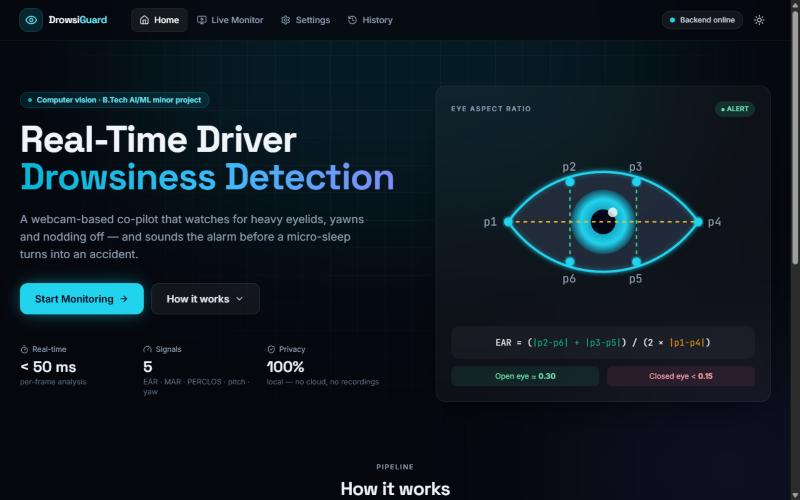
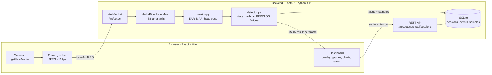
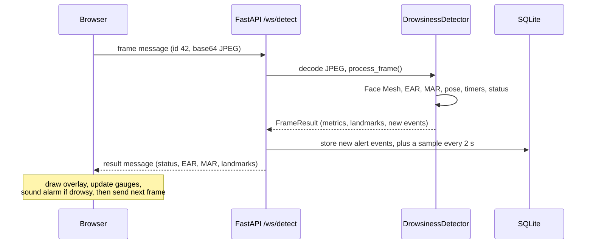

# Real-Time Driver Drowsiness Detection System

A webcam-based co-pilot that watches the driver's face in real time, detects **eye closure, yawning and head nodding**, and raises a **visual and audio alarm** before a micro-sleep turns into an accident. Everything runs locally on an ordinary laptop: no cloud, no special hardware.




> B.Tech AI/ML minor project.

---

## Contents

- [Features](#features)
- [Screenshots](#screenshots)
- [Architecture](#architecture)
- [How it works](#how-it-works): EAR, MAR, PERCLOS, head pose, fatigue score
- [Getting started (Windows)](#getting-started-windows)
- [Using the app](#using-the-app)
- [Running the tests](#running-the-tests)
- [API reference](#api-reference)
- [Configuration](#configuration)
- [Project structure](#project-structure)
- [Results](#results)
- [Limitations](#limitations) · [Future scope](#future-scope)
- [Troubleshooting](#troubleshooting)
- [References](#references)

---

## Features

**Detection (Python backend)**
- 468-point face tracking with **MediaPipe Face Mesh**
- **Eye Aspect Ratio (EAR)** → blink counting and drowsiness (eyes closed ≥ 1.5 s)
- **Mouth Aspect Ratio (MAR)** → yawn detection and counting
- **Head pose** (pitch / yaw via OpenCV `solvePnP`) → head-nod and looking-away alerts
- **PERCLOS** (percentage of eye closure over the last 60 s)
- Combined **Fatigue Score (0–100)** with a per-factor breakdown
- Time-based rules (frame-rate independent); graceful "no face" handling
- Every alert logged to **SQLite**, grouped by driving session

**Dashboard (React frontend)**
- Live webcam with a canvas overlay of eye and lip contours, coloured by state
- Animated gauges (EAR, MAR, Fatigue), live 30-second EAR/MAR chart with threshold lines
- Stat cards: blinks, blink rate, yawns, head nods, PERCLOS, session time
- **Drowsiness alarm**: full-screen flashing red border, shake animation, loud siren generated with the **Web Audio API**, Dismiss button and mute toggle
- Toast notifications and an event timeline
- **Settings** with live preview and **5-second personal calibration**
- **History & analytics**: fatigue-over-time charts, alert trends, **CSV export**
- Dark/light theme, responsive layout, auto-reconnecting WebSocket with a connection indicator

---

## Screenshots

| Screen | |
|---|---|
| Landing page |  |
| Live monitor | *Add `docs/screenshots/monitor.png`* |
| Drowsiness alarm | *Add `docs/screenshots/alarm.png`* |
| Settings & calibration | *Add `docs/screenshots/settings.png`* |
| History & analytics | *Add `docs/screenshots/history.png`* |

> To add a screenshot: press <kbd>Win</kbd> + <kbd>Shift</kbd> + <kbd>S</kbd>, save it in `docs/screenshots/` with the name above, and replace the placeholder text with ``.

---

## Architecture

The browser owns the camera; the Python backend owns the computer vision. They talk over a single WebSocket.



**Life of one frame**



Design choices:
- **One frame in flight.** The browser sends the next frame only after the previous result arrives, so a slow machine skips frames instead of building a queue.
- **One detector per session.** The detector, with its timers and counters, lives on the server keyed by session id, so an auto-reconnect continues the same counts.
- **Normalised landmarks.** Points are returned in 0–1 coordinates; the browser scales them to whatever size the video is displayed at.
- **Mirroring.** The video and overlay are mirrored together for a natural "selfie" view, while the backend analyses the un-mirrored image.

---

## How it works

### Eye Aspect Ratio (EAR)

Six landmarks per eye (p1, p4 = corners; p2, p3 = upper lid; p5, p6 = lower lid):

$$
\mathrm{EAR} = \frac{\lVert p_2 - p_6 \rVert + \lVert p_3 - p_5 \rVert}{2\,\lVert p_1 - p_4 \rVert}
$$

- Open eye ≈ **0.30** (measured 0.30–0.33 on the test user); closed eye < 0.15.
- Averaged over both eyes and computed in **pixel** space (not normalised coordinates, which would distort the ratio on a 4:3 image).
- Being a ratio, EAR does not change with distance from the camera.

| Rule | Default |
|---|---|
| Eyes closed | EAR < **0.23** (or your calibrated value) |
| Blink | closed for ≤ **0.4 s** |
| **Drowsy** | closed for ≥ **1.5 s** |

MediaPipe indices: right eye `33, 160, 158, 133, 153, 144`; left eye `362, 385, 387, 263, 373, 380`.

### Mouth Aspect Ratio (MAR)

Three pairs of inner-lip points (upper *u*, lower *l*) and the two mouth corners *c*:

$$
\mathrm{MAR} = \frac{\frac{1}{3}\sum_{i=1}^{3}\lVert u_i - l_i \rVert}{\lVert c_L - c_R \rVert}
$$

Closed ≈ 0, talking ≈ 0.2–0.4. **Yawn** = MAR > **0.6** held for ≥ **1 s** (counted once per yawn).
Indices: corners `78, 308`; upper `81, 13, 311`; lower `178, 14, 402`.

### Head pose (solvePnP)

Six landmarks (nose tip, chin, outer eye corners, mouth corners) are matched to a generic 3-D face model. OpenCV's `solvePnP` finds the rotation that projects the model onto the observed points (pinhole camera, focal length ≈ image width), and `RQDecomp3x3` turns it into **pitch** (positive = head down) and **yaw**. Angles are smoothed with an exponential moving average and measured **relative to the driver's calibrated neutral pose**.

- **Head nod** = pitch > **20°** (counted once per drop)
- **Distracted** = head down > 20° or turned > **30°** for ≥ **2 s**

### PERCLOS

$$
\mathrm{PERCLOS} = \frac{\text{frames with eyes closed}}{\text{frames observed}} \quad \text{over the last 60 s}
$$

Frames where the eye measurement is unreliable (head turned or down, mouth wide open) are **excluded**: looking down or yawning makes the eyes *look* narrow to the camera, and those behaviours are already scored separately.

### Fatigue Score (0–100)

$$
\text{Fatigue} = 100 \times \left(0.60\,P + 0.25\,Y + 0.15\,N\right)
$$

$$
P = \mathrm{clip}\!\left(\frac{\mathrm{PERCLOS} - 0.05}{0.30 - 0.05},\,0,\,1\right),\qquad
Y = \min\!\left(\frac{\text{yawns/min}}{3},\,1\right),\qquad
N = \min\!\left(\frac{\text{nods/min}}{3},\,1\right)
$$

- **PERCLOS** carries the most weight because it is the most validated single drowsiness indicator in driving research.
- The **5 % baseline** removes normal blinking (an alert driver's eyes are closed a few percent of the time).
- **Warm-up:** until 60 s have been observed, unseen time counts as normal, so one early yawn cannot push the score to 100.

| Example | Score |
|---|---|
| Calm driver (PERCLOS 4 %, no yawns/nods) | **0** |
| Tired (PERCLOS 20 %, 1 yawn/min) | **44** |
| Very drowsy (PERCLOS 35 %, 2 yawns + 2 nods/min) | **87** |

Bands used in the UI: < 40 low (green), 40–70 moderate (amber), ≥ 70 high (red).

### Status priority

`no_face` › `drowsy` › `yawning` › `distracted` › `alert`. Each alert fires **one event per episode** (latched until the condition clears). If no frame arrives for more than 1 s (paused or stalled stream), all duration timers restart, and paused time is not counted as session time.

### Personal calibration

The Settings page records 5 s of the driver looking at the screen normally, then:
- **EAR threshold** = 75 % of the **median** open-eye EAR (the median ignores the odd blink), clamped to 0.15–0.30;
- **Neutral pitch / yaw** = median head angles (a laptop camera usually sees the face from below).

It refuses to calibrate when fewer than 25 face frames are captured or the eyes look closed (median EAR < 0.18).

---

## Getting started (Windows)

### Prerequisites

| Tool | Version | Notes |
|---|---|---|
| Python | **3.11** | [python.org](https://www.python.org/downloads/) — tick *Add python.exe to PATH*. MediaPipe 0.10.14 needs 3.8–3.12; the project is tested on 3.11. |
| Node.js | 18 or newer (LTS) | [nodejs.org](https://nodejs.org/) |
| Browser | Chrome or Edge | Camera access works on `localhost` |
| Webcam | built-in or USB | |

### Option A — one command (recommended)

```bash
git clone https://github.com/h1teshrawat/driver-drowsiness-detection.git
```
```bash
cd driver-drowsiness-detection
```
```bash
.\start.bat
```

Or simply **double-click `start.bat`** in File Explorer. The first run creates the Python environment and installs everything (a few minutes). Every run opens the backend and frontend in two windows and launches the dashboard at **http://localhost:5173**. Close those two windows to stop.

### Option B — manual setup

**Backend** (terminal 1):
```bash
cd backend
```
```bash
py -3.11 -m venv .venv
```
```bash
.\.venv\Scripts\python.exe -m pip install -r requirements.txt
```
```bash
.\.venv\Scripts\python.exe run.py
```
API: http://127.0.0.1:8000 · interactive docs: http://127.0.0.1:8000/docs

**Frontend** (terminal 2):
```bash
cd frontend
```
```bash
npm install
```
```bash
npm run dev
```
Open **http://localhost:5173**. The Vite dev server proxies `/api` and `/ws` to the backend, so the browser only talks to one address.

**Quick check without the web app** — a plain OpenCV window with live metrics:
```bash
.\.venv\Scripts\python.exe scripts\webcam_test.py
```

---

## Using the app

1. **Settings → Calibrate (5 s)** — look at the screen normally. Your personal EAR threshold and neutral head pose are saved.
2. **Live Monitor → Start session** — allow camera access. Green contours = alert, amber = yawning, blue = distracted, red = drowsy.
3. Close your eyes for 2 s to see (and hear) the alarm. **Dismiss** silences the current episode; the mute button silences all sounds.
4. **Stop** saves the session. **History** shows its fatigue curve, alert markers and event log; export a session or all sessions as CSV.

---

## Running the tests

```bash
cd backend
```
```bash
.\.venv\Scripts\python.exe -m pytest
```

51 tests, ~4 s. They use a temporary database and settings file — your real data is never touched.

| File | Covers |
|---|---|
| `tests/test_metrics.py` | EAR/MAR formulas, scale invariance, PERCLOS window, event rates, fatigue score and worked examples, head-pose recovery from synthetic projections |
| `tests/test_detector.py` | State machine with scripted inputs: blink vs drowsy, one event per episode, yawns vs talking, nods and look-away, calibrated neutral pose, no face, pause handling, PERCLOS exclusions |
| `tests/test_api.py` | REST endpoints (validation, partial updates, 404/409), full session lifecycle over the WebSocket, event storage |

---

## API reference

### WebSocket `GET /ws/detect?session_id=<id>`

`session_id` is optional; without it nothing is logged (used by the settings preview and calibration).

Client → server:
```json
{"type": "frame", "id": 17, "image": "data:image/jpeg;base64,/9j/4AAQ..."}
{"type": "reset"}
{"type": "ping"}
```

Server → client (one per frame):
```json
{
  "type": "result", "frame_id": 17, "session_id": 8,
  "status": "alert", "face_detected": true,
  "ear": 0.312, "mar": 0.041, "perclos": 0.031,
  "blinks": 12, "blinks_per_min": 14.0, "yawns": 1, "nods": 0,
  "fatigue_score": 8.3, "fatigue_breakdown": {"perclos": 0.0, "yawn": 8.3, "nod": 0.0},
  "head_pose": {"pitch": 4.8, "yaw": -2.1, "roll": 0.6},
  "landmarks": {"left_eye": [[0.57, 0.41], "..."], "right_eye": [], "outer_lips": [], "inner_lips": [], "face_oval": []},
  "events": [], "session_seconds": 42.5, "processing_ms": 11.2
}
```
`status` is one of `alert`, `drowsy`, `yawning`, `distracted`, `no_face`. `events` contains a new alert (`drowsy` / `yawn` / `distracted`) on the frame it starts.

### REST

| Method | Path | Description |
|---|---|---|
| GET | `/api/health` | Liveness + list of active session ids |
| GET | `/api/settings` | Current thresholds |
| PUT | `/api/settings` | Update any subset of thresholds (validated, saved, applied on the next frame) |
| POST | `/api/settings/reset` | Restore defaults |
| POST | `/api/sessions/start` | Create a session → `{id, ...}` |
| POST | `/api/sessions/{id}/stop` | End a session, return its summary |
| GET | `/api/sessions` | All sessions (newest first) with alert counts |
| GET | `/api/sessions/{id}` | One session with its events and fatigue samples |
| DELETE | `/api/sessions/{id}` | Delete a finished session |

### Database

| Table | Contents |
|---|---|
| `sessions` | start/end time, active seconds, blinks, yawns, nods, average and peak fatigue |
| `events` | one row per alert: time, type, EAR, MAR, pitch, yaw, duration, details (JSON) |
| `samples` | a metrics snapshot every 2 s: EAR, MAR, PERCLOS, fatigue score |

---

## Configuration

All thresholds are editable on the Settings page (or `PUT /api/settings`) and stored in `backend/settings.json`.

| Setting | Default | Meaning |
|---|---|---|
| `ear_threshold` | 0.23 | EAR below this = eyes closed |
| `drowsy_duration_s` | 1.5 | eyes closed this long = drowsy |
| `blink_max_duration_s` | 0.4 | closures up to this long = blink |
| `mar_threshold` | 0.6 | MAR above this = mouth wide open |
| `yawn_duration_s` | 1.0 | mouth open this long = yawn |
| `head_pitch_threshold_deg` | 20 | head down beyond this = nod |
| `head_yaw_threshold_deg` | 30 | head turned beyond this = looking away |
| `head_pose_duration_s` | 2.0 | out of range this long = distracted |
| `head_pitch_offset_deg`, `head_yaw_offset_deg` | 0 | neutral pose (set by calibration) |
| `perclos_window_s` | 60 | PERCLOS / rate window |
| `alarm_volume` | 0.8 | siren and chime volume |

---

## Project structure

```
driver-drowsiness-detection/
├── backend/
│   ├── app/
│   │   ├── config.py        # Settings model + JSON persistence
│   │   ├── metrics.py       # EAR, MAR, head pose, PERCLOS, rates, fatigue (pure maths)
│   │   ├── detector.py      # DrowsinessDetector: MediaPipe + per-session state machine
│   │   ├── db.py            # SQLite: sessions, events, samples
│   │   ├── schemas.py       # Pydantic request/response models
│   │   └── api.py           # FastAPI app: /ws/detect + REST endpoints
│   ├── scripts/
│   │   ├── webcam_test.py   # standalone OpenCV demo
│   │   └── ws_client_test.py# streams the webcam to the API from Python
│   ├── tests/               # pytest suite (51 tests)
│   ├── requirements.txt
│   └── run.py               # starts uvicorn
├── frontend/
│   ├── src/
│   │   ├── pages/           # Landing, Monitor, Settings, History
│   │   ├── components/      # VideoFeed, OverlayCanvas, Gauge, LiveChart, AlarmOverlay, ...
│   │   ├── hooks/           # useWebcam, useDetectionSocket, useRollingChart
│   │   ├── context/         # theme, connection status, toasts
│   │   └── lib/             # api client, alarm (Web Audio), calibration, CSV, types
│   ├── package.json
│   └── vite.config.ts       # dev proxy for /api and /ws
├── docs/screenshots/
├── start.ps1 / start.bat    # one-command launcher
└── README.md
```

---

## Results

Measured on the development laptop with its built-in webcam (CPU only):

| Metric | Value |
|---|---|
| OpenCV prototype frame rate | 29–31 fps |
| Backend processing per frame (Face Mesh + metrics) | 8–18 ms |
| Web dashboard stream rate | ~12 fps (by design) |
| Normal open-eye EAR (test user) | 0.30–0.33 |
| Alert states verified live | drowsy, yawning, distracted (nod and look-away), no face |
| Automated tests | 51 passing |

Example logged session (30 s, deliberate test): 1 drowsy, 1 yawn and 2 look-away alerts, 13 blinks — each stored with EAR, MAR and head angles.

---

## Limitations

- An ordinary RGB webcam struggles in low light and at night.
- Sunglasses and strong reflections on glasses can hide the eyes.
- Large head turns make eye measurements unreliable (these frames are excluded from PERCLOS, but the eyes cannot be judged while turned away).
- Head angles are approximate: a generic 3-D face model and an uncalibrated camera are assumed.
- Fatigue weights are heuristic and tested on a single user; a proper study across many drivers is needed to validate them.
- A laptop webcam on a desk is not the same viewpoint as a dashboard-mounted camera.

## Future scope

- Infrared camera for night driving.
- Run on an in-car edge device (Raspberry Pi 5, NVIDIA Jetson) with a dashboard-mounted camera.
- A CNN eye-state classifier alongside EAR for robustness to glasses and lighting.
- Vehicle integration: seat or steering-wheel vibration, speed-aware alert levels.
- Multi-driver evaluation and learned (rather than hand-tuned) fatigue weights.
- Mobile app version.

---

## Troubleshooting

| Problem | Fix |
|---|---|
| *"Camera is being used by another application"* | Close Zoom/Teams/the OpenCV test window, then retry. |
| *Camera permission denied* | Click the camera icon in the address bar → Allow, then reload. Windows: Settings → Privacy & security → Camera → allow desktop apps. |
| `start.ps1` *"running scripts is disabled"* | Use `start.bat` (it bypasses the policy for this script only), or run `Set-ExecutionPolicy -Scope CurrentUser RemoteSigned`. |
| *Backend offline* in the navbar | Start the backend (`python run.py` in `backend`). |
| *Port 8000 / 5173 already in use* | Another copy is running; close it or reuse it (`start.ps1` detects this). |
| `npm install` fails with **EPERM** inside OneDrive | Pause OneDrive sync while installing, or move the project outside OneDrive. |
| MediaPipe import error mentioning NumPy | Keep `numpy==1.26.4` (MediaPipe 0.10.14 is built against NumPy 1.x). |
| `mp.solutions` not found | Use `mediapipe==0.10.14` as pinned in `requirements.txt`. |
| Too many false drowsy alerts | Run **Settings → Calibrate**, or raise *Drowsy duration*. |

---

## References

1. T. Soukupová and J. Čech, "Real-Time Eye Blink Detection using Facial Landmarks," *21st Computer Vision Winter Workshop*, 2016.
2. D. F. Dinges and R. Grace, "PERCLOS: A Valid Psychophysiological Measure of Alertness as Assessed by Psychomotor Vigilance," FHWA Tech Brief FHWA-MCRT-98-006, 1998.
3. W. W. Wierwille et al., "Research on Vehicle-Based Driver Status/Performance Monitoring," NHTSA Report DOT HS 808 247, 1994.
4. Y. Kartynnik, A. Ablavatski, I. Grishchenko and M. Grundmann, "Real-time Facial Surface Geometry from Monocular Video on Mobile GPUs," CVPR Workshops, 2019 (MediaPipe Face Mesh).
5. OpenCV documentation: `solvePnP`, `Rodrigues`, `RQDecomp3x3`.
